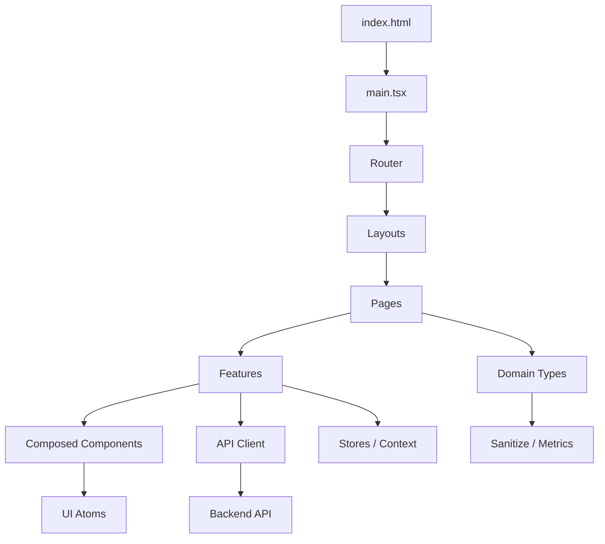

# Migração Vue 3 → React 18 + TypeScript + Vite (web-react) — Design

**Spec:** `.code-spec-driven/SPEC.md`
**Status:** Draft

---

## Architecture Overview

Reconstrução em React 18 + TypeScript + Vite do front-end Cadterreiros, seguindo a arquitetura hierárquica atômica definida em `web-react/AGENT.md` §2.2. A identidade visual é herdada do protótipo open-design (`.artifacts/`), com tokens em OKLch e CSS puro. O comportamento é reimplementado a partir do `web/` (Vue) e da `api/`.

### Pattern Justification

| Criterio | React + TS + Vite + CSS puro | Vue 3 (atual) | MUI/Chakra/Tailwind |
|----------|------------------------------|---------------|---------------------|
| Identidade visual | CSS puro + tokens (controle total) | Vuetify (elevação, sombra) | Framework CSS (conflita com tokens) |
| Type safety | TypeScript strict | JavaScript (sem TS) | — |
| Bundle size | Vite + tree-shaking | Vite + Vuetify (pesado) | — |
| Manutenibilidade | Componentes atômicos por escopo | Componentes monolíticos | — |
| Acessibilidade | Controle manual (aria-*) | Vuetify (parcial) | — |

### Architecture Diagram



---

## Code Reuse Analysis

### Existing Components to Leverage

| Component | Location | How to Use |
|-----------|----------|------------|
| Tokens (fonte) | `.artifacts/tokens.mjs` | Copiar para `web-react/scripts/tokens.mjs` e rodar `build-tokens` |
| CSS base | `.artifacts/css/base.css` | Portar para `web-react/src/styles/base.css` |
| CSS components | `.artifacts/css/components.css` | Portar para `web-react/src/styles/components.css` |
| CSS pages | `.artifacts/css/pages.css` | Portar para `web-react/src/styles/pages.css` |
| CSS design-system | `.artifacts/css/design-system.css` | Portar para `web-react/src/styles/design-system.css` |
| Tokens CSS | `.artifacts/css/tokens.css` | Gerar via `build-tokens.mjs` (não copiar à mão) |
| Fontes | `.artifacts/fonts/` (19 woff2 + 2 CSS) | Copiar para `web-react/public/fonts/` |
| Brand spec | `.artifacts/brand-spec.md` | Referência de identidade (não código) |
| Mock HTML | `open-design/.od/projects/bd938936/index.html` | Referência de layout (não copiar JSX) |
| Mock app.js | `open-design/.od/projects/bd938936/assets/app.js` | Referência de lógica de UI (inspiração) |
| Mock prototype.css | `open-design/.od/projects/bd938936/assets/css/prototype.css` | Referência de CSS completo (2.565 linhas) |
| Dados | `.artifacts/data/communities.json` (214), `stats.json` | Seed/mock para desenvolvimento |
| Rotas Vue | `web/src/router/base.js`, `auth.js`, `index.js` | Referência de rotas e guards |
| Stores Vue | `web/src/stores/*.js` | Referência de estado (reimplementar em Context) |
| Services Vue | `web/src/services/*.js` | Referência de API calls (portar para `src/api/`) |
| Enums Vue | `web/src/enum/*.js` | Referência de constantes (portar para `src/domain/`) |
| Utils Vue | `web/src/utils/*.js` | Referência de utilitários (portar para `src/utils/`) |

### Integration Points

| System | Integration Method |
|--------|-------------------|
| Backend API | axios client em `src/api/client.ts` + módulos por recurso |
| MongoDB | via API (não acessa diretamente) |
| Leaflet | `leaflet` + `leaflet.markercluster` (decisão do projeto) |
| Google Maps | API key (já no Vue, manter) |

---

## Components

### `src/components/ui/` (átomos)

- **Button** — primário (persimmon), ghost, quiet, danger; estados: hover, focus, disabled, loading
- **TextInput** — campo de texto com label, erro (`aria-describedby`), validação
- **Select** — dropdown com opções
- **Card** — cartão branco com fio 1px, sem sombra
- **Badge** — etiqueta (nação, status, tipo)
- **Modal** — diálogo nativo `<dialog>` com `showModal()`
- **EmptyState** — estado vazio com CTA
- **Stat** — número grande + caption (serif)
- **Toast** — notificação (aria-live)
- **Spinner** — loading state
- **Chip** — etiqueta de filtro

### `src/components/composed/` (moléculas)

- **SearchField** — input + botão de busca
- **Pagination** — pager com botões
- **EmptyState** — estado vazio reutilizável
- **Stat** — número + caption (serif)
- **NationLegend** — legenda das 8 nações
- **FilterBar** — filtros do mapeamento (busca, nação, cidade, tipo)
- **CookieBanner** — banner fixo no rodapé, 3 botões (Aceitar/Rejeitar/Personalizar), persistência em localStorage (chave `cadterreiros.consent`)
### `src/components/layout/`

- **Nav** — navegação principal + drawer mobile
- **Footer** — rodapé com grid
- **PageShell** — wrapper de página (head + body)

### `src/features/`

- **communities/** — CommunityCard, CommunityDetail, CommunityList, SearchFilters
- **census/** — CensusStep, CensusTable, RegistrationForm
- **auth/** — LoginForm, OTPForm, SetPasswordForm
- **metrics/** — MappingCharts (nação, cidade, década, tipo×nação, tipo, gênero, etnia, linguagem, bairro, cobertura)

### `src/pages/`

- **Home** — hero, stats, featured (9 mais antigos), mapeamento em números
- **Search** — busca com filtros e paginação
- **Community** — ficha completa
- **CommunityRegister** — cadastro voluntário (multi-step)
- **AboutProject** — artigo sobre o projeto
- **Login** — login
- **OTP** — verificação OTP
- **SetEmailForm** — recuperação de senha
- **SetPassword** — definição de senha
- **GridFAQLanguages/Nations/TraditionalCommunities/AboutCCIAO** — FAQs
- **Mapping** — mapeamento com mapa + gráficos
- **Dashboard** (fase 2) — admin

---

## Data Models

### `src/domain/types.ts`

```typescript
interface CommunityAddress {
  fullAddress: string;
  street: string;
  number: string;
  neighborhood: string;
  city: string;
  state: string;
  zipcode: string;
}

interface GeoLocation {
  lat: number;
  long: number;
}

interface Contacts {
  phone?: string | number;
  mobile?: string | number;
  email?: string;
}

type CommunityType = 'matriz africana' | 'comunidade de terreiro';
type ReligiousSpaceNation = 'angola' | 'ekiti efon' | 'jeje' | 'ketu' | 'nagô' | 'quimbanda' | 'tambor de mina' | 'umbanda' | 'outros';
type ReligiousSpacePraticalLanguages = 'yoruba' | 'quicongo' | 'umbundo' | 'ewe fon' | 'outros';
type EReligiousSpaceStatus = 'active' | 'inactive';
type ECensusStep = 'approved' | 'pending' | 'rejected';

interface ReligiousCommunity {
  id: string;
  authorization: boolean;
  communityGoogleApiLocalization: GeoLocation;
  communityAddress: CommunityAddress;
  communityType: CommunityType;
  religiousSpaceYearFoundation: number;
  religiousSpaceLeaderFoundation: string;
  religiousSpaceNation: ReligiousSpaceNation;
  religiousSpacePraticalLanguages: ReligiousSpacePraticalLanguages;
  religiousSpaceName: string;
  religiousSpaceLeaderName: string;
  religiousSpacePositionName: string;
  religiousSpaceStartedBy: string;
  religiousSpaceNameDateStartedBy: string;
  leaderContacts?: Contacts;
  leaderEthnicity: string;
  leaderGender: string;
  leaderEducationalLevel: string;
  leaderSocialProgram?: object | null;
  leaderSufferedRacism: boolean;
  religiousSpaceMainPicture?: string;
  religiousSpaceStatus: EReligiousSpaceStatus;
  religiousSpaceEvents?: unknown[];
  bio?: string;
  censusStep: ECensusStep;
  censusTaker?: string | null; // opcional para cadastro voluntário
  rejectedReason?: string;
  registeredVoluntarily: boolean; // nova prop
  createdAt: string;
  updatedAt: string;
}

interface NationStats { nation: string; count: number; }
interface CityStats { city: string; count: number; }
interface DecadeStats { decade: string; count: number; }
interface TypeByNationStats { nation: string; african: number; traditional: number; }
interface GenderStats { gender: string; count: number; }
interface EthnicityStats { ethnicity: string; count: number; }
interface LanguageStats { language: string; count: number; }
interface NeighborhoodStats { neighborhood: string; count: number; }
interface PhotoCoverageStats { withPhoto: number; withoutPhoto: number; total: number; }
interface SummaryStats { total: number; cities: number; neighborhoods: number; }
interface CensusStepStats { step: string; count: number; }
interface StatusStats { status: string; count: number; }
interface EducationalLevelStats { level: string; count: number; }
interface BioCoverageStats { withBio: number; withoutBio: number; total: number; }
interface VoluntaryStats { voluntary: number; census: number; total: number; }
```

### `src/domain/sanitize.ts`

Regras de saneamento (do AGENT.md §2.4.3):
- `religiousSpaceYearFoundation` = `0` ou `20` → "não informado"
- `city: "Brazil"` → "não informado"
- `languages: "outros"` → "não informado"
- `censusTaker` objeto|string → normalizar

### `src/domain/metrics.ts`

Cálculo de métricas agregadas (do mock `build-metrics.mjs`):
- Total, cidades, bairros, com foto, com fundação
- Por nação, por cidade, por década, por tipo×nação
- Concentração por bairro (top N + cauda longa)

---

## Error Handling Strategy

| Scenario | Handling | User Impact |
|----------|----------|-------------|
| Payload inválido no cadastro | Validação strict (class-validator) → 400 + erros por campo | Formulário mostra erros inline |
| Rate-limit excedido | 429 + `Retry-After` | Toast "muitas tentativas, aguarde" |
| Header `x-cadterreiros-api` ausente | 403 | Toast "acesso não autorizado" |
| Erro de rede | Fallback + retry | Estado de erro visível |
| Lista vazia | Empty state com CTA | "Nenhum terreiro encontrado" |
| Sessão expirada | Redirect para `/entrar` | Toast "sessão expirada" |
| Foto ausente | Manter cadastro (não obrigatório) | Placeholder de foto |
| Consentimento ausente | Exibir banner de cookies | Banner fixo no rodapé |
| Consentimento negado | Não carregar GA4 (analytics_storage: denied) | Analytics desativado |
---

## Risks & Concerns

| Concern | Location | Impact | Mitigation |
|---------|----------|--------|------------|
| Imagens do mock não batem com uploads atuais | `.artifacts/data/communities.json` → `api/uploads/` | 0 de 199 UUIDs encontrados | Revalidar contra API real antes de publicar |
| Protótipo JSX perdido (open-design vazio) | `open-design/.od/projects/` | Referência de layout perdida | Usar CSS + mock HTML como referência |
| `censusTaker` opcional pode quebrar lookups | `ReligiousCommunitySchema` | `$lookup` com null | Tratar null no service (fallback "não informado") |
| Rate-limit em memória (single instance) | `express-rate-limit` | Não escala horizontalmente | Usar Redis store em produção |
| `class-validator` nova dependência | `api/package.json` | Aumenta bundle da API | Aceitável (segurança) |
| Gates não executáveis | `.artifacts/scripts/` | Esperam estrutura `app/` | Portar para `web-react/scripts/` |
| GA4 pode não carregar se consentimento negado | Consent Mode v2 | Impacto em analytics | Respeitar escolha do usuário (LGPD) |
---

## Tech Decisions

| Decision | Choice | Rationale |
|----------|--------|-----------|
| Framework | React 18 + TS + Vite | AGENT.md §2.3 — sem frameworks CSS/JS |
| Estado | Context (auth) + colocation | AGENT.md §2.1.4 |
| HTTP client | axios | Já usado no Vue, familiar |
| Mapa | Leaflet + markercluster | Decisão do projeto |
| Validação (API) | class-validator | Strict, type-safe |
| Rate-limit | express-rate-limit | Simples, suficiente para MVP |
| Header de segurança | `x-cadterreiros-api` (valor fixo por env) | Impede acesso direto à API |
| Persistência de cadastro voluntário | `registeredVoluntarily: boolean` (default false) | Marca origem do cadastro |
| Upload de foto no cadastro voluntário | Permitir público (com segurança) | Simplifica o fluxo |
| `getRandom` | Removido (substituído por `getOldest`) | Decisão do usuário |
| `/public/mapping` | Unificado em `/public/stats/summary` | Decisão do usuário |
| `by-neighborhood` | Top 10 + "outros" | Decisão do usuário |
| `by-census-taker` | Não implementar | Decisão do usuário |
| Consent Mode v2 | Google Consent Mode v2 | Bloqueia GA4 até consentimento (LGPD) |
| Persistência de consentimento | localStorage (`cadterreiros.consent`) | Sem dependência externa, respeita escolha |
| Dependência externa de cookies | Nenhuma | Implementação própria (sem lib de terceiros) |
> **Project-level decisions:** Append to `.code-spec-driven/state.json` if this sets a convention future features must follow.